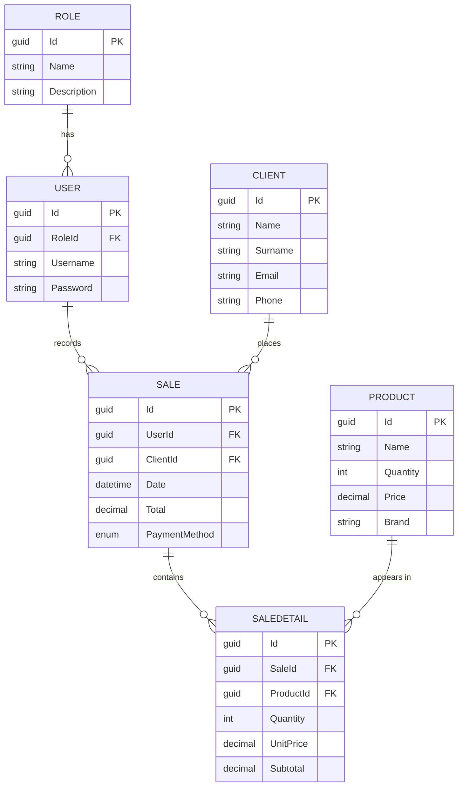

<!--
  Pending badge: enable it only once a LICENSE file exists.
  Uncomment it and move it into the block below.

  [](LICENSE)
-->

<div align="center">

# Store API

**Sales-management REST API built with ASP.NET Core 10, EF Core, and PostgreSQL.**

[](https://github.com/Mirandaaca/store-api-dotnet10/actions/workflows/ci.yml)
[](https://dotnet.microsoft.com/)
[](https://learn.microsoft.com/ef/core/)
[](https://www.postgresql.org/)
[](#roadmap)
[](https://github.com/Mirandaaca/store-api-dotnet10/stargazers)
[](https://github.com/Mirandaaca/store-api-dotnet10/commits/main)

</div>

---

## About the project

A REST API for managing a store: clients, products, users and roles, and sales with their line items. It follows a **layered architecture** (Controller → Service → Repository) with explicit separation through interfaces and dependency injection.

The project has two goals:

1. **Build a well-structured REST API** using current ASP.NET Core 10 and Entity Framework Core practices.
2. **Set up a complete CI/CD pipeline** on a self-hosted Ubuntu server: when a tag is published, Jenkins builds the project, applies the migrations, and updates the `systemd` service in production with no manual steps.

> [!NOTE]
> Under active development. The **clients**, **products**, and **roles** modules expose endpoints; the remaining entities (users, sales, and sale details) are modeled and migrated but don't have a service layer yet. See the [roadmap](#roadmap).

---

## Architecture

Each layer depends only on the abstraction of the next one, so implementations can be swapped and tested in isolation.

```
HTTP Request
     │
     ▼
┌─────────────────┐   Receives the request, validates the
│   Controller    │   binding, and delegates. Knows nothing
└────────┬────────┘   about EF Core.
         │ IClientService
         ▼
┌─────────────────┐   Business logic and Entity ⇄ DTO
│    Service      │   mapping. Throws domain exceptions.
└────────┬────────┘
         │ IClientRepository
         ▼
┌─────────────────┐   Data access. The only layer that
│   Repository    │   touches the DbContext.
└────────┬────────┘
         │ StoreContext
         ▼
┌─────────────────┐
│   PostgreSQL    │
└─────────────────┘
```

**Design decisions**

| Element | Reason |
|---|---|
| DTOs separate from entities | Avoids exposing the domain model and navigation properties through the API. `ClientDTO` (write) and `ReadClientDTO` (read) keep the `Id` read-only. |
| Domain exceptions | Each exception inherits from `DomainException` and declares its own `StatusCode` and `Title`, so `DomainExceptionHandler` translates any of them without knowing the concrete types. |
| `AsNoTracking()` on reads | Read-only queries don't need EF Core's change tracker. |
| `Guid` primary keys | IDs can be generated on the client and don't collide when data from different sources is merged. |

---

## Data model



Available payment methods (`PaymentMethodEnum`): `Cash`, `CreditCard`, `DebitCard`, `QRCode`, `BankTransfer`.

---

## Stack

| Component | Technology |
|---|---|
| Framework | ASP.NET Core 10.0 (Web API) |
| ORM | Entity Framework Core 10.0 |
| Database | PostgreSQL (`Npgsql` provider) |
| Validation | [FluentValidation](https://docs.fluentvalidation.net/) 12 |
| Errors | `ProblemDetails` (RFC 9457) through `IExceptionHandler` |
| Documentation | OpenAPI + [Scalar](https://scalar.com/) |
| Language | C# 14 · `Nullable` and `ImplicitUsings` enabled |

---

## Prerequisites

- [.NET SDK 10.0](https://dotnet.microsoft.com/download/dotnet/10.0) or later
- A reachable **PostgreSQL** instance (local, Docker, or a managed service such as [Render](https://render.com/) or [Neon](https://neon.tech/))
- The `dotnet-ef` tool to manage migrations:

  ```bash
  dotnet tool install --global dotnet-ef
  ```

Check the installation with:

```bash
dotnet --version    # should report 10.x
dotnet ef --version
```

<details>
<summary><b>Run PostgreSQL with Docker (optional)</b></summary>

```bash
docker run --name store-db \
  -e POSTGRES_USER=store_user \
  -e POSTGRES_PASSWORD=store_password \
  -e POSTGRES_DB=storedb \
  -p 5432:5432 \
  -d postgres:16
```

</details>

---

## Getting started

**1. Clone the repository**

```bash
git clone https://github.com/Mirandaaca/store-api-dotnet10.git
cd store-api-dotnet10
```

**2. Configure the connection string**

`appsettings.json` is excluded from version control because it contains credentials. Create it at `CIWithJenkins/appsettings.json` with the following content:

```json
{
  "Logging": {
    "LogLevel": {
      "Default": "Information",
      "Microsoft.AspNetCore": "Warning"
    }
  },
  "ConnectionStrings": {
    "DefaultConnection": "Host=localhost;Port=5432;Database=storedb;User ID=store_user;Password=store_password;"
  },
  "AllowedHosts": "*"
}
```

> [!WARNING]
> Don't commit this file. For real environments, prefer environment variables:
> ```bash
> export ConnectionStrings__DefaultConnection="Host=...;Database=...;User ID=...;Password=..."
> ```
> ASP.NET Core gives them priority over `appsettings.json`, with no code changes.

**3. Restore dependencies and apply the migrations**

```bash
dotnet restore
dotnet ef database update --project CIWithJenkins
```

**4. Run**

```bash
dotnet run --project CIWithJenkins
```

The API is available at:

| Profile | URL |
|---|---|
| HTTP | `http://localhost:5026` |
| HTTPS | `https://localhost:7291` |

---

## Interactive documentation

In the development environment, the API reference is generated automatically and served with Scalar:

| Resource | URL |
|---|---|
| Scalar UI | `http://localhost:5026/scalar/v1` |
| OpenAPI document | `http://localhost:5026/openapi/v1.json` |

Both endpoints are only registered when `ASPNETCORE_ENVIRONMENT=Development`.

---

## Endpoints

### Clients — `/api/Client`

| Method | Route | Description | Body | Response |
|---|---|---|---|---|
| `GET` | `/api/Client` | Lists all clients | — | `200` · `ReadClientDTO[]` |
| `GET` | `/api/Client/{id}` | Gets a client by its `Guid` | — | `200` · `ReadClientDTO` |
| `POST` | `/api/Client` | Creates a client | `ClientDTO` | `201` |
| `PUT` | `/api/Client/{id}` | Updates an existing client | `ClientDTO` | `204` |
| `DELETE` | `/api/Client/{id}` | Deletes a client | — | `204` |

### Products — `/api/Product`

| Method | Route | Description | Body | Response |
|---|---|---|---|---|
| `GET` | `/api/Product` | Lists all products | — | `200` · `ReadProductDTO[]` |
| `GET` | `/api/Product/{id}` | Gets a product by its `Guid` | — | `200` · `ReadProductDTO` |
| `POST` | `/api/Product` | Creates a product | `ProductDTO` | `201` |
| `PUT` | `/api/Product/{id}` | Updates an existing product | `ProductDTO` | `204` |
| `DELETE` | `/api/Product/{id}` | Deletes a product | — | `204` |

### Roles — `/api/Role`

| Method | Route | Description | Body | Response |
|---|---|---|---|---|
| `GET` | `/api/Role` | Lists all roles | — | `200` · `ReadRoleDTO[]` |
| `GET` | `/api/Role/{id}` | Gets a role by its `Guid` | — | `200` · `ReadRoleDTO` |
| `POST` | `/api/Role` | Creates a role | `RoleDTO` | `201` |
| `PUT` | `/api/Role/{id}` | Updates an existing role | `RoleDTO` | `204` |
| `DELETE` | `/api/Role/{id}` | Deletes a role | — | `204` |

**Schemas**

```jsonc
// ClientDTO — input for POST and PUT
{
  "name": "Cristopher",
  "surname": "Miranda",
  "email": "cristopher@example.com",
  "phone": "70000000"
}

// ReadClientDTO — output (adds the generated Id)
{
  "id": "3fa85f64-5717-4562-b3fc-2c963f66afa6",
  "name": "Cristopher",
  "surname": "Miranda",
  "email": "cristopher@example.com",
  "phone": "70000000"
}

// ProductDTO — input for POST and PUT
{
  "name": "Mechanical keyboard",
  "quantity": 25,
  "price": 349.90,
  "brand": "Keychron"
}

// ReadProductDTO — output (adds the generated Id)
{
  "id": "9c1f2a30-4b8e-4d21-9f6a-1e7c5b2d8a04",
  "name": "Mechanical keyboard",
  "quantity": 25,
  "price": 349.90,
  "brand": "Keychron"
}

// RoleDTO — input for POST and PUT (ReadRoleDTO adds the generated Id)
{
  "name": "Cashier",
  "description": "Records sales at the point of sale"
}
```

**Example**

```bash
curl -X POST http://localhost:5026/api/Client \
  -H "Content-Type: application/json" \
  -d '{"name":"Cristopher","surname":"Miranda","email":"cristopher@example.com","phone":"70000000"}'
```

---

## Error handling

All errors are returned as `application/problem+json` following **RFC 9457 (ProblemDetails)**, with a `traceId` that links the response to its log entry.

| Situation | Status | Source |
|---|---|---|
| Invalid input | `400` | `FluentValidation` → `ValidationProblemDetails` |
| Resource not found | `404` | `ClientNotFoundException`, `ProductNotFoundException`, `RoleNotFoundException` |
| Unexpected failure | `500` | Fully logged on the server; only the `traceId` is returned |

```jsonc
// GET /api/Client/3fa85f64-5717-4562-b3fc-2c963f66afa6
{
  "type": "https://tools.ietf.org/html/rfc9110#section-15.5.5",
  "title": "Resource not found",
  "status": 404,
  "detail": "A client with Id '3fa85f64-5717-4562-b3fc-2c963f66afa6' was not found.",
  "instance": "GET /api/Client/3fa85f64-5717-4562-b3fc-2c963f66afa6",
  "traceId": "00-73d18169243c629ad8feb8c6d3dc67dd-d4c6362a159c1003-00"
}

// POST /api/Product with no brand, a negative quantity, and a price of zero
{
  "type": "https://tools.ietf.org/html/rfc9110#section-15.5.1",
  "title": "One or more validation errors",
  "status": 400,
  "instance": "POST /api/Product",
  "errors": {
    "Brand": ["Brand is required."],
    "Quantity": ["The quantity cannot be negative."],
    "Price": ["The price must be greater than zero."]
  }
}
```

Every domain exception inherits from `DomainException` and declares its own `StatusCode` and `Title`. That's why `DomainExceptionHandler` doesn't know any concrete exception: adding a new module doesn't require changing it.

---

## Project structure

```
CIWithJenkins/
├── Configurations/     Fluent API mapping for each entity (IEntityTypeConfiguration<T>)
├── Context/            StoreContext — DbContext configuration and DbSets
├── Controllers/        HTTP endpoints
├── DTOs/               Data transfer objects, grouped by module
├── Entities/           Domain model mapped by EF Core
├── Enums/              Domain enumerations
├── Exceptions/         Domain exceptions with their HTTP status code
├── Handlers/           DomainExceptionHandler — translates exceptions into ProblemDetails
├── Interfaces/
│   ├── Repository/     Data access contracts
│   └── Services/       Business logic contracts
├── Migrations/         Migrations generated by EF Core
├── Repository/         Data access implementations
├── Services/           Business logic implementations
├── Validators/         Input validation rules (FluentValidation)
└── Program.cs          Application composition and dependency registration
```

Every new module follows the same vertical slice: entity → DTOs → validator → repository interface → repository → service interface → service → controller, then the repository and service are registered in `Program.cs`. Validators are discovered automatically.

---

## Roadmap

**API**

- [x] Data model and initial migrations
- [x] Clients CRUD with a layered architecture
- [x] Products CRUD
- [x] Roles CRUD
- [x] Global exception handling (domain exceptions translated into `ProblemDetails`)
- [x] Input validation with FluentValidation
- [ ] Users CRUD
- [ ] Sales with line items and total calculation
- [ ] JWT authentication and authorization
- [ ] Pagination and filtering on list endpoints
- [ ] Unit of Work pattern for transactional operations
- [ ] Health check endpoint (`/health`)

**Quality**

- [ ] Unit tests for the service layer (xUnit + Moq)
- [ ] Integration tests with Testcontainers

**Infrastructure**

- [x] GitHub Actions CI workflow (build on every push and pull request to `main`; runs the tests once a test project exists)
- [ ] Deployment `Jenkinsfile` triggered by `v*` tags
- [ ] Automated deployment to a `systemd` service on Ubuntu, with releases and rollback
- [ ] Migrations applied during deployment with EF Core migration bundles

---

## Author

**Cristopher Miranda** — [@Mirandaaca](https://github.com/Mirandaaca)
